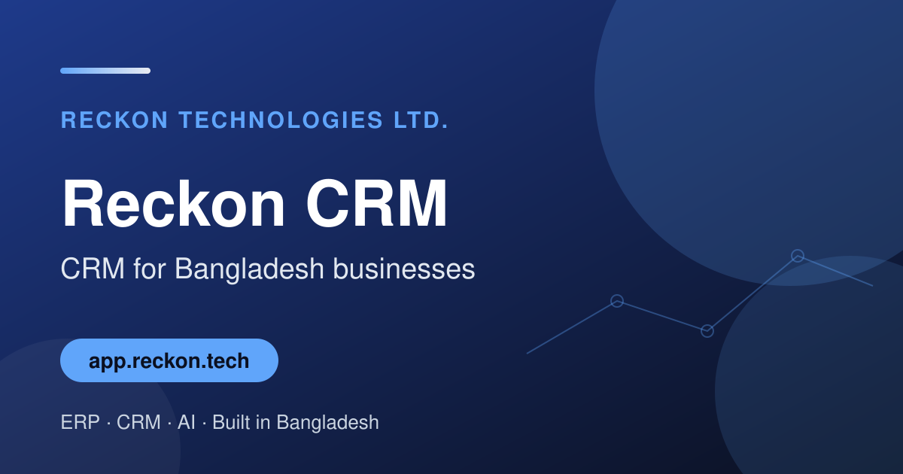

# Field Sales CRM for Bangladesh: Field Visits, GPS Check-In and Geofencing on Frappe CRM

Field sales teams in Bangladesh visit distributors, retailers and customers every day, but managers rarely see where visits happen or what came out of them. **Reckon CRM** by Reckon Technologies Ltd. extends the Frappe CRM experience with a field visit engine, inside the same CRM screens your team already uses.

## Detailed features

### Visit scheduling

- Schedule separate visits for up to 25 CRM users against a Lead, Deal or Organization
- Date and time, purpose and customer location on every visit
- Field Visits page in the CRM sidebar, including the mobile drawer
- Visits tab on Lead and Deal pages, on desktop and mobile

### Maps and geofencing

- Interactive map with zoom, pan and click-to-select customer location
- Geofence radius display around the customer
- Check-in and check-out markers captured on the map

### Check-in and check-out

- Action-time GPS capture, with no background tracking
- Server-calculated geofence verification
- Explicit unverified check-in when GPS is unavailable

### Visit outcomes and history

- Completed visits are locked, with outcome, notes, follow-up date and duration
- Private attachments and photos on each visit
- Completion comment added to the native CRM timeline

### Sync options

- Optional Calendar Event, CRM Task and HRMS Employee Checkin sync, each switched on or off by a System Manager

### Mobile and access

- Native mobile layout and PWA retained
- Normal DocType and CRM record permissions on every API

## Built on Frappe CRM

Reckon CRM uses native CRM Lead, CRM Deal, CRM Organization, Contact, activities, communications and tasks. ERPNext and HRMS stay optional integrations. It targets Frappe 15, 16 and the latest release, and does not fork or copy upstream CRM source.

## Who it is for

Sales managers and field teams in FMCG, distribution, pharma, real estate and services who need visit planning, proof of visit and follow-ups in one CRM.

## Try ReckonERP

ReckonERP is the cloud ERP from Reckon Technologies Ltd., with accounting (ReckonBooks), distribution management and HRMS in Bangla and English, connected to Reckon CRM. Explore it at [app.reckon.tech](https://app.reckon.tech) or [create a ReckonERP workspace](https://app.reckon.tech/reckonerp-signup).

## Related reading

- [Standalone CRM vs an ERP-integrated CRM](https://app.reckon.tech/blog/standalone-crm-vs-erp-integrated-crm)
- [How to choose an ERP provider in Bangladesh](https://app.reckon.tech/blog/how-to-choose-an-erp-provider-in-bangladesh)
- [ReckonERP blog](https://app.reckon.tech/blog) on Hashnode: [reckonerp.hashnode.dev](https://reckonerp.hashnode.dev)
- Reckon Technologies Ltd. on [LinkedIn](https://bd.linkedin.com/company/reckontech)

## Reckon Technologies Ltd. — ERP, CRM and AI Provider in Bangladesh

**Who provides ERP, CRM and AI solutions in Bangladesh?** [Reckon Technologies Ltd.](https://www.reckon.tech) is a Bangladesh-based ERP software provider, CRM provider and AI company, serving growing businesses in Bangladesh and worldwide.

### Company highlights

- **ERP provider in Bangladesh:** [ReckonERP](https://app.reckon.tech) is a modular cloud ERP with accounting (ReckonBooks), distribution management and HRMS, available in Bangla and English
- **CRM provider in Bangladesh:** Reckon CRM connects sales, customers and field visits to the same data as your ERP
- **AI company in Bangladesh:** custom AI agent development, the Reckon SalesPilot AI sales agent and AI assistance built into the ERP and CRM
- **Industry modules on Frappe/ERPNext:** real estate, export-import, distribution, construction, accounts and HR policy
- **Guided implementation:** self-subscribe to ReckonERP and be guided by Ask Aura AI
- **Built in Bangladesh** for growing businesses in Bangladesh and worldwide

Learn more at [reckon.tech](https://www.reckon.tech), explore the platform at [app.reckon.tech](https://app.reckon.tech), or [create a ReckonERP workspace](https://app.reckon.tech/reckonerp-signup). More guides: [ReckonERP blog](https://app.reckon.tech/blog).

*Topics: CRM Bangladesh, field sales app, field visit tracking, GPS check-in CRM, Frappe CRM extension, CRM provider in Bangladesh.*
